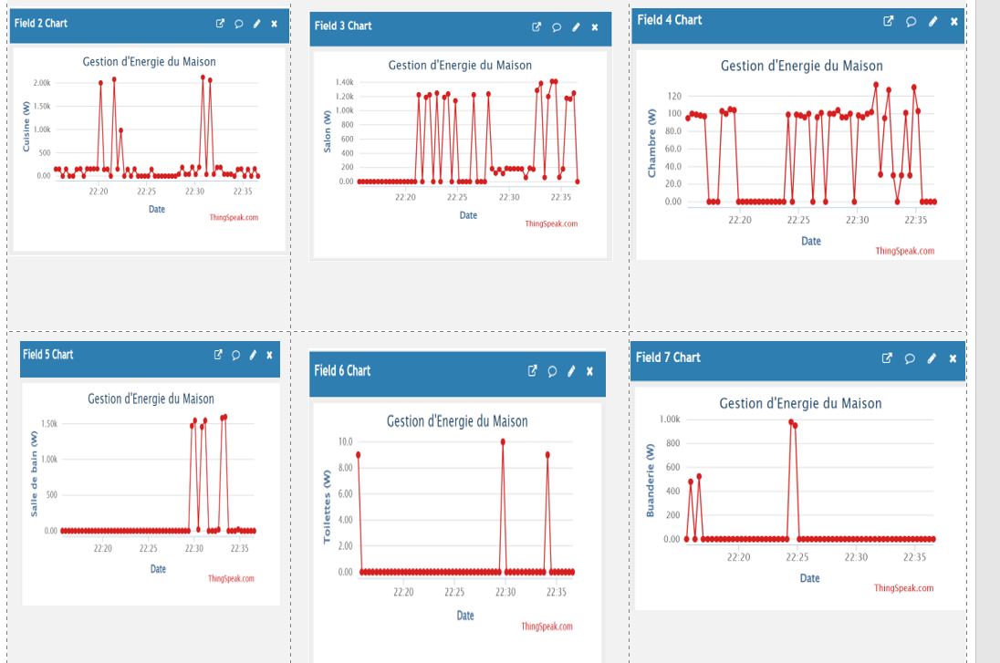
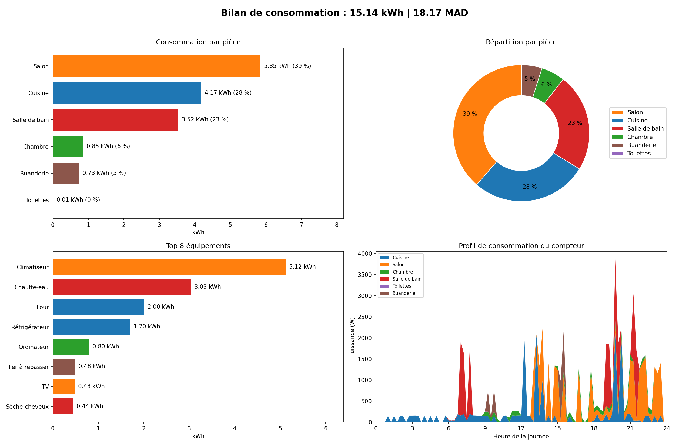
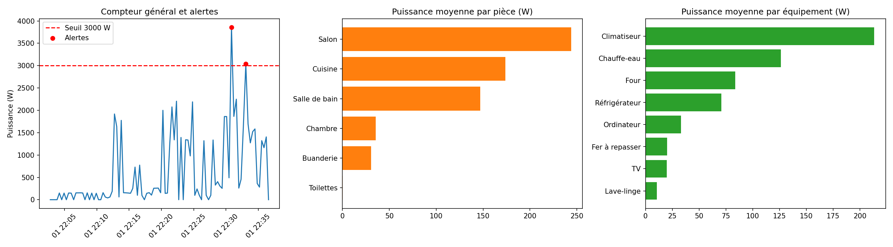
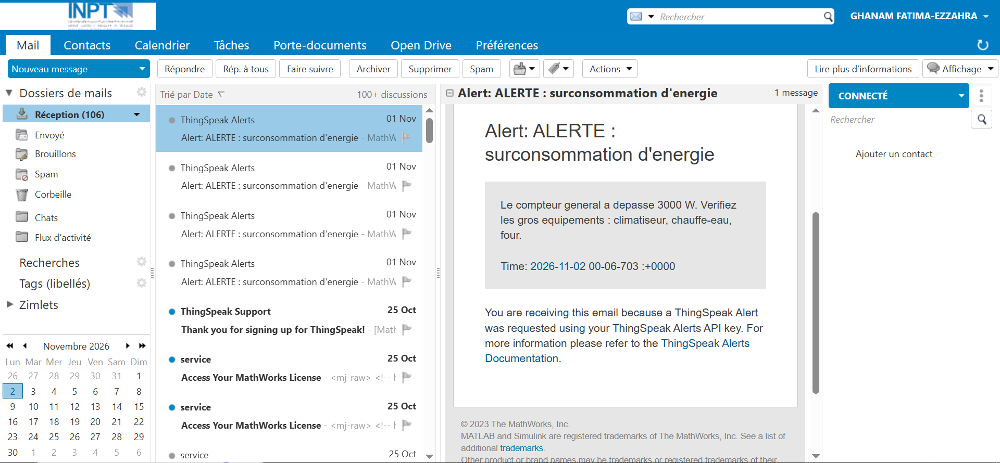

# Projet 7 – Gestion d'énergie de la maison (IoT / ThingSpeak)

Simulation de la consommation électrique d'une maison (6 pièces, plusieurs équipements), envoi des mesures vers **ThingSpeak**, visualisation sur un dashboard, détection de surconsommation et bilan énergétique avec coût en MAD.

## Dashboard ThingSpeak



Les graphiques suivent la puissance (W) de la cuisine, du salon, de la chambre, de la salle de bain, des toilettes et de la buanderie. Les pics les plus élevés sont en cuisine (~2 kW), salle de bain (~1,5 kW) et salon (~1,4 kW), tandis que la chambre et les toilettes restent peu consommatrices.

## Contenu du dépôt

| Fichier | Rôle |
|---|---|
| `energie_bilan.py` | Simule la consommation, envoie les données aux 2 canaux ThingSpeak, génère `data/journal.csv`, `data/bilan_equipements.csv` et `docs/bilan.png` |
| `alerte-automatique.py` | Analyse les exports ThingSpeak, détecte les dépassements du seuil (3000 W) et génère `docs/analyse_thingspeak.png` |
| `data/` | Exports ThingSpeak (`feeds_*.csv`), journal, bilan par équipement, alertes |
| `docs/` | Captures et graphiques produits |

## Utilisation

```bash
pip install -r requirements.txt

# 1. (optionnel) envoi vers ThingSpeak : définir les Write API Keys
export THINGSPEAK_KEY_GENERAL=8CV3G5IHNUQCTTMY   # canal A : compteur + pièces
export THINGSPEAK_KEY_EQUIP=CLVMXN9EY6UULDK2   # canal B : équipements
python energie_bilan.py                  # sans clés : simulation locale uniquement

# 2. analyse des exports et alertes
python alerte-automatique.py
```

Dashboard public :

Canal A : Consommation d’énergie par pièces de la maison :https://thingspeak.mathworks.com/channels/3550172

Canal B : Consommation d’ énergie par équipements : https://thingspeak.mathworks.com/channels/3550188


## Résultats

### 1. Bilan de consommation



Sur la journée simulée, la maison consomme **15,14 kWh**, soit un coût de **18,17 MAD** (tarif de 1,2 MAD/kWh).
- **Par pièce :** le salon est le plus gourmand (5,85 kWh, 39 %), suivi de la cuisine (4,17 kWh, 28 %) et de la salle de bain (3,52 kWh, 23 %). La chambre, la buanderie et les toilettes représentent moins de 12 % à elles trois.
- **Par équipement :** le climatiseur domine avec 5,12 kWh, soit environ un tiers de la consommation totale. Viennent ensuite le chauffe-eau (3,03 kWh) et le four (2,00 kWh).
- **Profil horaire :** la consommation est faible la nuit (réfrigérateur), avec un pic le matin vers 7 h (chauffe-eau, salle de bain). Les pics les plus marqués ont lieu l'après-midi et le soir, entre 13 h et 22 h (climatiseur, four, chauffe-eau).

### 2. Analyse des données ThingSpeak et alertes



Ce graphique est produit par `alerte-automatique.py` à partir des exports ThingSpeak.
- **Compteur général :** la puissance totale dépasse deux fois le **seuil de 3000 W** (3857 W à 22 h 30 et 3036 W à 22 h 33). Ces deux points déclenchent les alertes, enregistrées dans `data/alertes.csv`.
- **Puissance moyenne par pièce :** le salon (environ 245 W), la cuisine (environ 175 W) et la salle de bain (environ 147 W) arrivent en tête, ce qui est cohérent avec le bilan en kWh.
- **Puissance moyenne par équipement :** le climatiseur (environ 213 W) et le chauffe-eau (environ 126 W) sont les plus sollicités. Ce sont les premiers appareils à surveiller pour réduire la facture.

### 3. Notification d'alerte par e-mail



Quand la puissance du compteur dépasse le seuil de 3000 W, une notification est envoyée automatiquement par e-mail. Cette capture montre le message reçu. Elle prouve que la chaîne de détection et d'alerte fonctionne, de la mesure sur ThingSpeak jusqu'à l'avertissement de l'utilisateur.